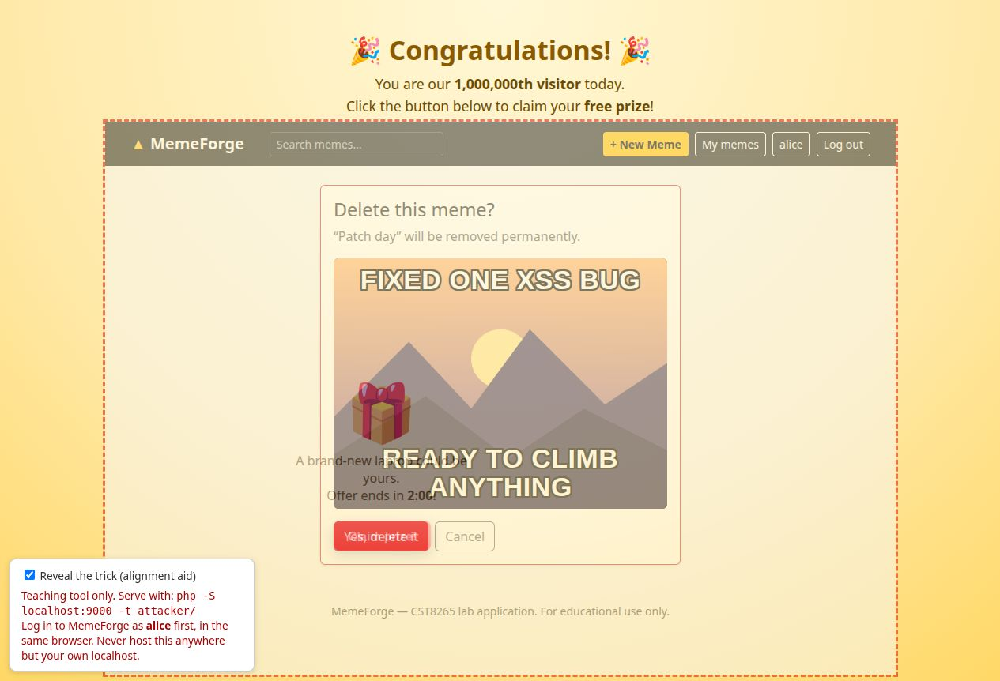
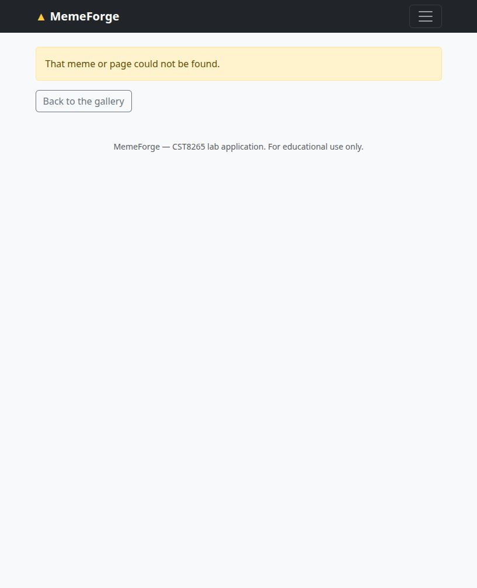
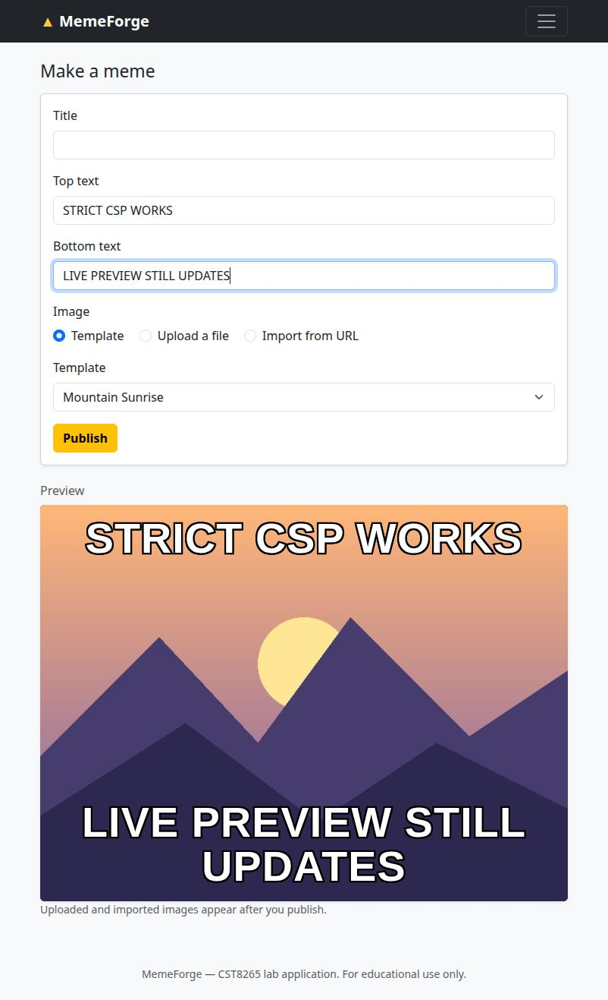
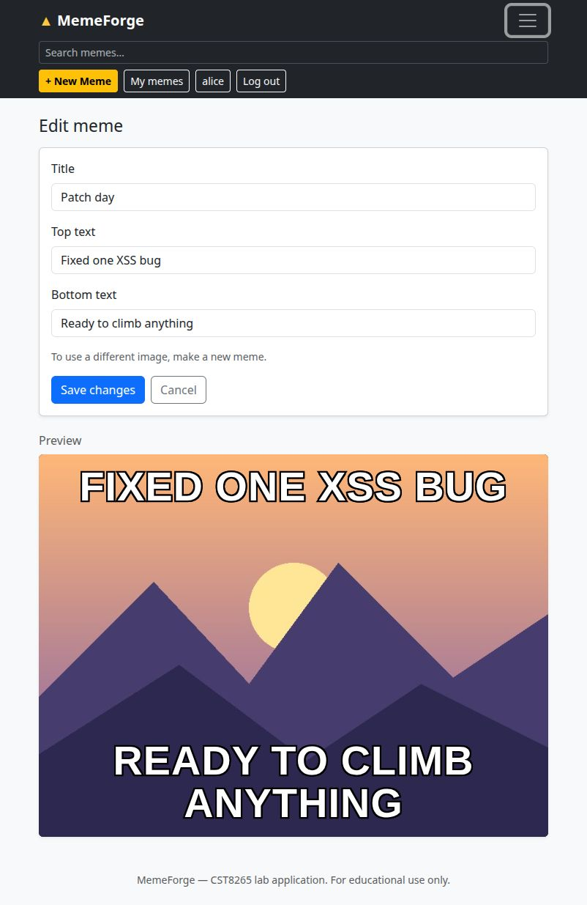
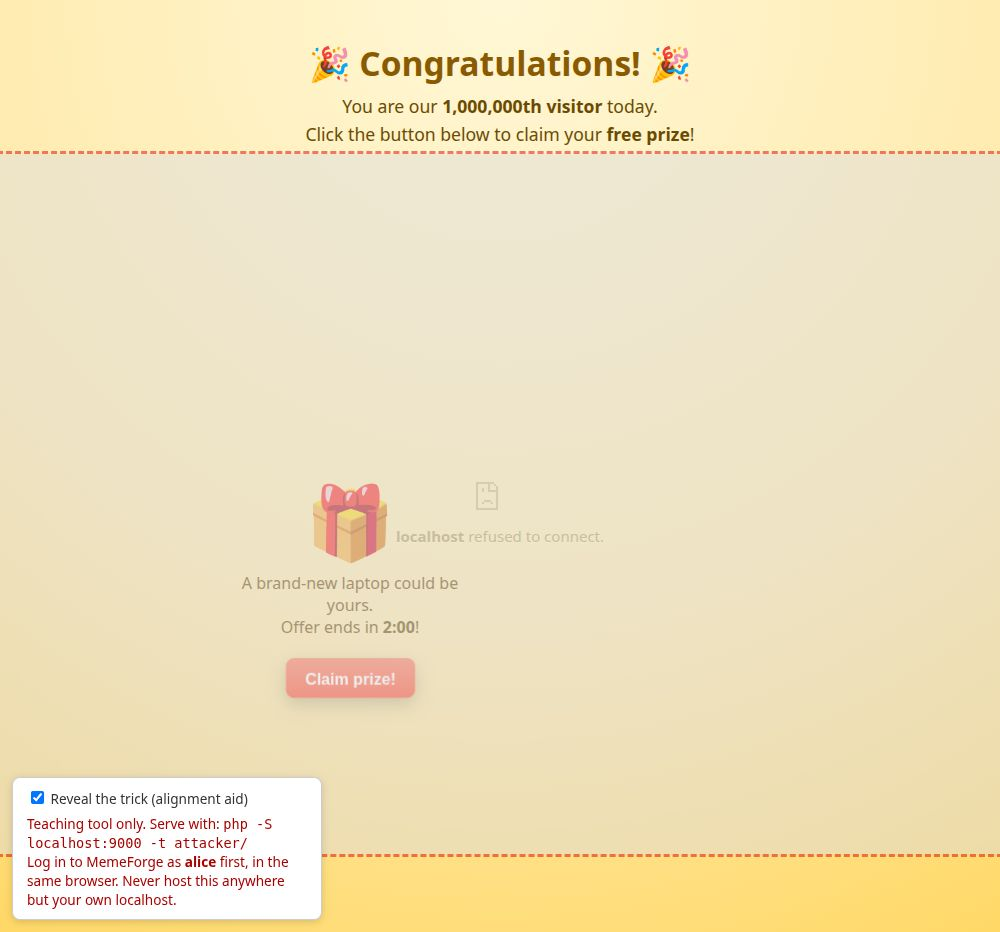
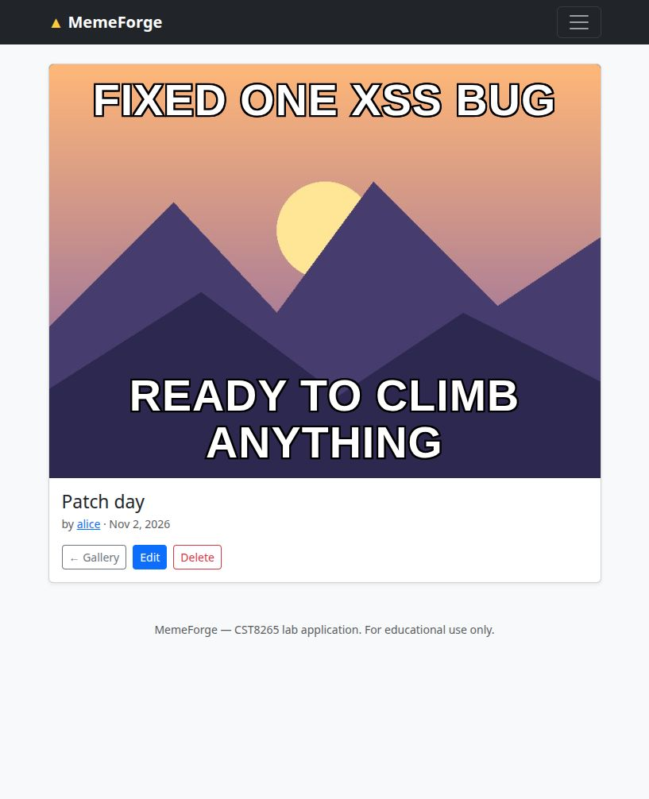

# MemeForge hardening log

Test date: November 14, 2026. Environment: PHP 8.5.4, SQLite, localhost ports 8000 and 9000, Chromium-based in-app browser. The instructor-provided clickjack project was kept outside this repository. Screenshots and CSP reports below are actual captures.

## Part A — Baseline

Before changing application source, `curl -I http://localhost:8000/` returned:

```http
HTTP/1.1 200 OK
Host: localhost:8000
Date: Sat, 14 Nov 2026 13:24:24 GMT
Connection: close
X-Powered-By: PHP/8.5.4
Set-Cookie: PHPSESSID=[redacted]; path=/
Expires: Thu, 19 Nov 1981 08:52:00 GMT
Cache-Control: no-store, no-cache, must-revalidate
Pragma: no-cache
Content-type: text/html; charset=UTF-8
```

The session cookie lacked `HttpOnly`, an explicit `SameSite` policy and `Secure`. Without HttpOnly, JavaScript running in the application's origin could read the session identifier; without Secure, it is not restricted to HTTPS transport. Browsers may default an unspecified SameSite to Lax, but relying on an implicit browser default is weaker than declaring the intended policy. Other origins do not automatically gain permission to read cookies; SameSite primarily limits cookie transmission with cross-site requests. No CSP, framing protection, MIME-sniffing protection, referrer policy or permissions policy was present, and X-Powered-By disclosed the PHP version.

**Evidence limitation:** The baseline above is an actual curl HEAD response. A separate pre-change DevTools Network response-header capture was not saved, so a claimed browser/curl comparison would be unsupported. Date and session identifier can differ between requests, and an existing browser session may receive no new Set-Cookie header.

## Part B — Clickjacking

Logged in as alice, opened the genuine delete confirmation for meme 1 (“Patch day”), and selected Cancel. The attacker page at localhost:9000 loaded that confirmation in its transparent iframe. With the alignment aid enabled, the decoy overlapped the red delete button.



After the click attempts against the framed form/decoy, meme 1 was absent from SQLite and its public page returned Not found. Some browser-automation actions returned stale-target errors; the verified result is the missing meme, rather than a claim that every click command succeeded. No direct delete request or database deletion was used to produce this result.



The real form supplied the real CSRF token and used Alice's authenticated session, so CSRF validation and ownership checks did not reject the action. Ports 8000 and 9000 are different origins but the same site: SameSite cookies alone do not stop this localhost demonstration. Restored the sample database using the supplied build script before testing the defense.

## Part C — CSP rollout and shared headers

Started with `Content-Security-Policy-Report-Only: default-src 'self'; object-src 'none'; base-uri 'self'; form-action 'self'`. For objective evidence, temporarily added a local `report-uri` receiver: the browser submitted real CSP violation reports. That receiver and report-uri were removed from the final application. [Original report-only evidence](docs/csp-report-only.jsonl) and [reports after fixes](docs/csp-fixed-report-only.jsonl) are retained.

| Blocked resource | Pages | Effective directive | Fix and reason |
| --- | --- | --- | --- |
| jsDelivr Bootstrap 5.3.3 CSS | All rendered pages | style-src-elem, falling back to default-src | Self-hosted as assets/bootstrap.min.css; no CDN host is trusted by CSP. Added SHA-384 SRI. |
| jsDelivr Bootstrap bundle | All rendered pages | script-src-elem, falling back to default-src | Self-hosted as assets/bootstrap.bundle.min.js with SHA-384 SRI. Preserved the MIT license and documented update responsibility. |
| Inline brand-color style block | All rendered pages | style-src-elem | Moved rule into assets/app.css. |
| Inline sticky preview style attributes | New Meme and Edit | style-src-attr | Replaced with the meme-preview-sticky class in app.css. |
| Inline live-caption preview script | New Meme and Edit | script-src-elem | Moved unchanged behavior into assets/preview.js and loaded it with defer. Captions still use textContent. |
| Embedded data: SVG images in Bootstrap CSS | Navbar at narrow widths and relevant form controls | img-src | Allowed data: only in img-src; scripts remain limited to self. |
| Additional inline-style report at line 135, column 93882, without source-file | Every page in the automated browser | style-src-elem | Remained after all application inline styles were removed. The DOM contained no style elements. This appears to originate from browser tooling; it is documented, not used to justify unsafe-inline. |

The automated console-log API returned no messages, so the report receiver provides the violation evidence instead. All identified application-resource violations disappeared after the fixes; the separate browser-tooling style report remained. A completely clean DevTools Console in a normal browser remains a manual verification item.

All application response headers are set once in `src/helpers.php`, before output and session_start:

```http
HTTP/1.1 200 OK
Host: localhost:8000
Date: Sat, 14 Nov 2026 13:28:05 GMT
Connection: close
Content-Security-Policy: default-src 'self'; script-src 'self'; style-src 'self'; img-src 'self' data:; object-src 'none'; base-uri 'self'; form-action 'self'; frame-ancestors 'none'
X-Frame-Options: DENY
X-Content-Type-Options: nosniff
Referrer-Policy: strict-origin-when-cross-origin
Permissions-Policy: camera=(), microphone=(), geolocation=()
Strict-Transport-Security: max-age=31536000; includeSubDomains
Set-Cookie: PHPSESSID=[redacted]; path=/; HttpOnly; SameSite=Lax
Expires: Thu, 19 Nov 1981 08:52:00 GMT
Cache-Control: no-store, no-cache, must-revalidate
Pragma: no-cache
Content-type: text/html; charset=UTF-8
```

The enforced CSP forbids framing with frame-ancestors 'none'. X-Frame-Options: DENY provides an additional legacy fallback. No unsafe-inline or unsafe-eval directive is used. Session cookies are HttpOnly and SameSite=Lax; Secure is enabled when PHP receives an HTTPS request and remains false for this HTTP localhost environment. Production behind a TLS-terminating proxy must configure the trusted server's HTTPS indication correctly rather than trusting arbitrary client-supplied forwarding headers.

### Verification

PHP syntax checks passed for every PHP source file; the external preview JavaScript passed node --check, and git diff --check passed. HTTP checks verified all six hardening headers, removal of X-Powered-By and HttpOnly/SameSite cookies on normal, login, registration, authentication-redirect and missing-meme responses. [Enforcement reports](docs/csp-enforced.jsonl) include the rejected frame.

Visited gallery, search, single meme, user page, New Meme, Edit, delete confirmation and Account settings while logged in. Log in and Register were visited while logged out so their actual forms were tested rather than their authenticated redirects. Repeated gallery, New Meme and Edit at 390 × 844, and exercised the collapsed navigation. Repeated this page coverage after enforcement.





After enforcement, reloading the attacker page with the reveal control enabled displayed “localhost refused to connect” in the iframe. The browser also submitted a frame-ancestors violation report. Meme 1 remained accessible in the genuine application.





### Reflections

**1. Defense in depth.** Output encoding prevents untrusted text from becoming HTML or JavaScript at known output points. CSP adds a browser-enforced boundary if another component introduces executable content. For example, a compromised reverse-proxy HTML-injection module could append an inline script after the secure PHP application generated its response; this policy would block that script. CSP supplements output encoding and does not replace it.

**2. Why the token did not help.** Clickjacking tricks the user into interacting with the genuine application inside a frame. That genuine page already contains a valid CSRF token and submits it with the user's authenticated cookie. Because Alice owns the meme, the ownership check also succeeds. Forbidding framing prevents the attacker from embedding the actionable page under the decoy in the first place. [Framing policy reference](https://developer.mozilla.org/en-US/docs/Web/HTTP/Reference/Headers/Content-Security-Policy/frame-ancestors).

**3. Trusting a CDN.** This implementation self-hosts Bootstrap, taking responsibility for reviewing security updates and replacing the pinned files and integrity hashes. Allowing all of cdn.jsdelivr.net in script-src would trust more than Bootstrap, including other package resources served by that host. An attacker with an injection flaw could try to load attacker-controlled or exploitable JavaScript from that allowed host. An integrity attribute pins the expected file bytes so the browser rejects altered content, although it does not establish that the chosen version itself is safe. [SRI reference](https://developer.mozilla.org/en-US/docs/Web/Security/Defenses/Subresource_Integrity).

**4. What is still untested.** HSTS is ignored when received over HTTP, so seeing its header on localhost does not prove that HTTPS upgrades are enforced. Secure cookies normally require HTTPS, although browsers provide special localhost exceptions; this lab intentionally keeps Secure off for HTTP development. Production must serve the application through correctly configured HTTPS with a trusted certificate, enable Secure and verify cookie handling and subsequent HTTP-to-HTTPS upgrades in a real browser. HTTPS behavior was not tested here. [HSTS](https://developer.mozilla.org/en-US/docs/Web/HTTP/Reference/Headers/Strict-Transport-Security) and [cookie reference](https://developer.mozilla.org/en-US/docs/Web/HTTP/Reference/Headers/Set-Cookie).
